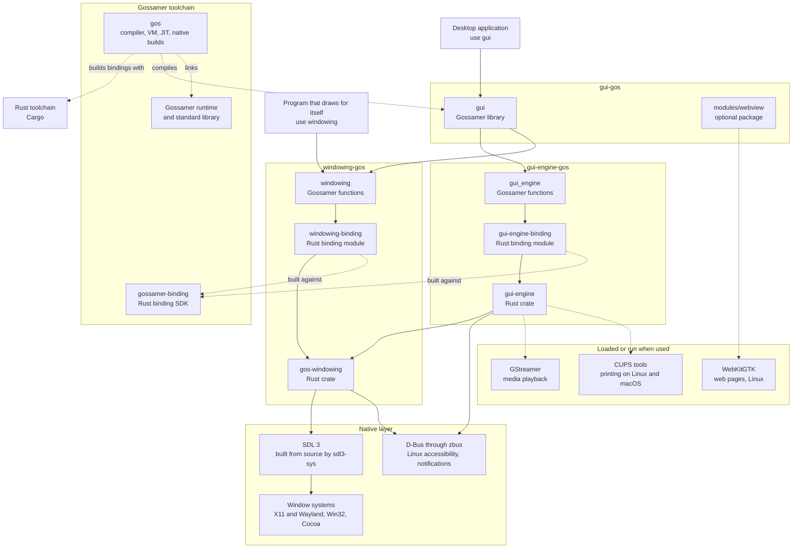

# GUI libraries

Three packages build native desktop programs in Gossamer. Each is its own
repository and release, and each sits on the one below it:

| Package | Import | Role |
|---|---|---|
| [GUI](../gui/index.md) (`gui-gos`) | `use gui` | The toolkit applications write against: the application loop, widgets, commands, dialogs, themes, localization and accessibility. |
| [GUI engine](../gui-engine/index.md) (`gui-engine-gos`) | `use gui_engine` | The toolkit's engine in Rust: layout, text shaping, painting, widget state and platform services. Applications reach it through `gui`. |
| [Windowing](../windowing/index.md) (`windowing-gos`) | `use windowing` | Native windows, input, the event loop and desktop services over SDL 3. Usable on its own by programs that draw for themselves. |

## Architecture

Solid arrows are build-time dependencies; dotted arrows are what the
toolchain builds or what the toolkit loads only when a feature is used.

## How the layers meet

- **Gossamer to Rust.** Each package's Gossamer surface (`gui`, `gui_engine`,
  `windowing`) calls a Rust binding module declared under `[rust-bindings]`
  in its `project.toml`. `gos` builds the bindings with Cargo against the
  binding SDK it ships (`gos env` reports it as `binding_sdk`), so a program
  needs a Rust toolchain to build but no Rust code of its own.
- **gui to the engine.** Widget trees, messages and queries cross the
  `gui_engine` binding as JSON. Gossamer closures the toolkit calls back (a
  view, an update, a custom widget's drawing) cross as registered ids and run
  on the UI thread.
- **The engine to windowing.** The engine uses the `gos-windowing` crate
  directly, in Rust; `gui` also imports `windowing` for the types it shares
  with applications. Both reach the same windowing release.
- **Windowing to the platform.** No SDL call leaves `gos-windowing`. SDL
  supplies window surfaces and input events only; there is no Qt, GTK or
  Electron at any level. Platform services SDL does not cover (Linux
  accessibility and notifications, UI Automation on Windows, the macOS
  accessibility tree and menus) are implemented in `gos-windowing` and the
  engine.
- **Optional pieces.** GStreamer is loaded when a media player opens and
  the CUPS tools run when a document prints; neither is linked at build time.
  The web view is a separate package under `gui-gos/modules`, so applications
  that do not depend on it carry no WebKit, GTK or GLib.

## Versions

The three packages are released together. `gui-gos` depends on
`windowing-gos` and `gui-engine-gos` at their `v0.1.0` tags, `gui-engine-gos`
depends on `windowing-gos` at `v0.1.0`, and all three require Gossamer
`^v0.75.9`. `gos fetch` prepares the tagged dependencies.
